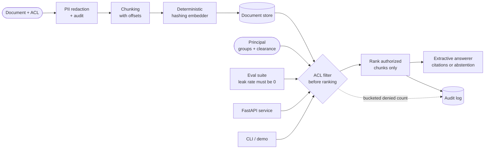

# Enterprise RAG Governance

A **permission-aware retrieval-augmented generation** platform for
enterprise use: documents carry ACLs and sensitivity levels, ingestion
redacts PII before anything is indexed, retrieval filters by the
requesting principal **before** ranking, answers are extractive with
chunk-level citations (and **abstain** when no authorized evidence
exists), a golden-question eval suite proves the guarantees, and every
retrieval is audit-logged without leaking what was denied.

The embedder and the answerer are **deterministic**, so the whole
platform runs offline with **no API keys and no LLM**. All data is
synthetic and all code is original — a clean-room build with no real
system behind it.

## The problem

Naive RAG is a confidentiality incident waiting for a query:

1. **One index for everyone** — similarity search happily retrieves a
   restricted memo for an intern, because relevance ignores clearance.
2. **Post-filtering leaks** — filtering a global top-k still reveals
   denied documents through result counts, rank gaps, and citations.
3. **PII in the index** — emails, card numbers, and IDs get embedded
   and quoted back verbatim to anyone whose query is close enough.
4. **Unverifiable answers** — generated prose with no citation to a
   specific chunk cannot be checked, and "the model said so" is not
   an audit trail.

## Architecture



Full design notes: [docs/architecture.md](docs/architecture.md).

## Access control model

| Sensitivity | Who can read it |
|---|---|
| `public` | Any principal with `public` clearance or above |
| `internal` | Any principal with `internal` clearance or above |
| `confidential` | Clearance ≥ confidential **and** owner, named user, or shared group |
| `restricted` | Clearance ≥ restricted **and** owner, named user, or shared group |

Clearance alone is never enough for the top two levels, and group
membership alone is never enough without clearance — both halves of
`Document.is_authorized` must pass, and that one function is the only
authorization rule in the codebase.

## Quickstart

Requires Python 3.11+.

```bash
pip install -r requirements.txt
pip install -e .

# End-to-end demo: ingest (with PII redaction) → authorized cited
# answer → unauthorized abstention → eval with zero leak rate
python examples/run_demo.py
# equivalently: enterprise-rag-governance demo
```

Run the service:

```bash
enterprise-rag-governance serve --port 8000
# POST /documents   ingest a document (redacted, chunked, embedded)
# POST /query       permission-aware retrieval + cited answer
# GET  /audit       retrieval + redaction audit entries
# POST /eval        run golden questions, return the metric report
# GET  /documents · GET /health
```

Ask a governed question with curl:

```bash
curl -s -X POST localhost:8000/query -H 'Content-Type: application/json' \
  -d '{"principal": {"user_id": "bob", "groups": ["finance"], "clearance": "confidential"},
       "query": "What revenue growth did the finance summary report?", "k": 5}'
```

Docker:

```bash
docker build -t enterprise-rag-governance .
docker run -p 8000:8000 enterprise-rag-governance
```

## Permission-aware retrieval

`PermissionAwareRetriever` is two-phase by construction: **filter,
then rank**. Only chunks from documents the principal is authorized
for are scored (cosine similarity over the hashing embedder, plus a
small token-overlap boost, fully deterministic ordering). Denied
documents cannot appear in results, citations, or answer text — and
they cannot leak through counts either: responses and audit entries
carry only a coarse denied bucket (`0`, `1-3`, `4-10`, `11+`), never
an exact count, a title, or an id.

## Citations and abstention

The extractive answerer composes answers **only** from sentences in
retrieved authorized chunks, verbatim. Every sentence carries a
`Citation(doc_id, chunk_id, start_char, end_char)` pointing into the
stored document text, so any claim can be verified in O(1). When no
authorized chunk clears the score threshold the answerer **abstains**
with a fixed refusal and no citations — identically for "it exists but
not for you" and "it does not exist".

## PII redaction

Ingestion detects and replaces email addresses, SSN-like, credit-card
-like, and phone patterns **before** chunking and embedding, and
stores only the redacted text. The redaction audit records the doc id
and per-kind counts — never the matched values — so the audit log does
not become a second copy of the data it protects.

## Evaluation

Golden questions pair a query + principal with the expected authorized
doc set and an abstention expectation. The suite reports:

- **recall@k** — expected authorized docs found in the top k
- **unauthorized-leak rate** — must be **0**; any leak blocks release
- **citation precision** — citations that resolve to retrieved,
  authorized chunks
- **abstention accuracy** — abstained exactly when expected

```bash
enterprise-rag-governance eval
```

## Testing

```bash
pytest -q
```

The suite covers ACL filtering (clearance, groups, ownership, grants),
PII detection/redaction for all four pattern kinds, chunking offsets
and overlap, retrieval ranking and the no-leak guarantees (results,
citations, counts), citation correctness against the stored text,
abstention for unauthorized and for absent evidence, eval metrics,
audit-log contents, and the FastAPI surface end to end.

CI: [docs/github-actions-ci.yml](docs/github-actions-ci.yml) is a
ready-to-use GitHub Actions workflow (move it to
`.github/workflows/ci.yml` to activate).

## Key design decisions and trade-offs

- **Filter before ranking.** Post-filtering leaks through counts and
  rank gaps and starves authorized evidence; filtering first makes
  "denied" mean *never scored*. In production the same predicate is an
  index-time ACL field filter in the vector store.
- **Extractive, not generative, answers.** Verbatim sentences make
  citation precision mechanically checkable and hallucination
  impossible by construction — the right default until a generative
  layer can be constrained to the same cited evidence.
- **Redact-and-store.** Read-time masking leaves PII in embeddings
  and backups; storing only redacted text keeps every downstream
  artifact clean. The governed source system stays the original's
  home.
- **Bucketed denied counts.** Exact counts are an oracle for
  restricted content ("exactly one memo mentions X"); a bucket is an
  operational signal without the disclosure.
- **Deterministic embedder.** A hashing embedder is semantically
  weaker than a hosted model but has zero drift, zero keys, and fully
  offline tests — and it sits behind a one-method seam.
- **Audit hashes, not queries.** Query text is itself sensitive; a
  SHA-256 prefix correlates repeat queries without storing them.

## What it demonstrates

- Designing RAG for **governance**: ACL-first retrieval, sensitivity
  levels, least-disclosure responses, and auditable denials.
- Production retrieval engineering: redaction pipelines, offset-true
  chunking, deterministic ranking, and eval gates (leak rate = 0) that
  map directly to enterprise AI-review conversations.
- An API + CLI surface a platform team could actually run, with the
  eval and audit outputs a Director-level reviewer asks for first.

## Limitations

- Single-process, in-memory store; a production deployment puts the
  same ACL predicate in front of a real vector index and a shared
  audit sink.
- Principals arrive per request in this reference build — terminate
  OIDC in front of it and derive the principal from the token.
- Regex PII detection is a first line, not a DLP product; pair it with
  a dedicated scanner for regulated corpora.
- The extractive answerer is intentionally literal: it will not
  synthesise across chunks beyond joining their best sentences.

## License

MIT — see [LICENSE](LICENSE).
