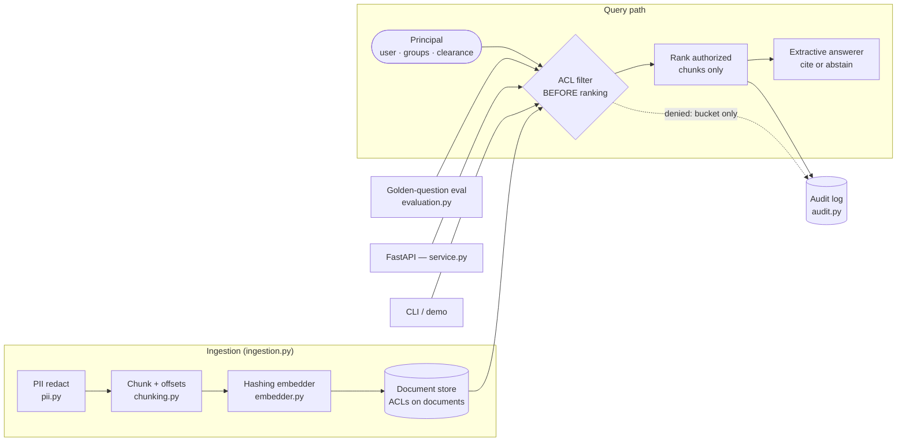
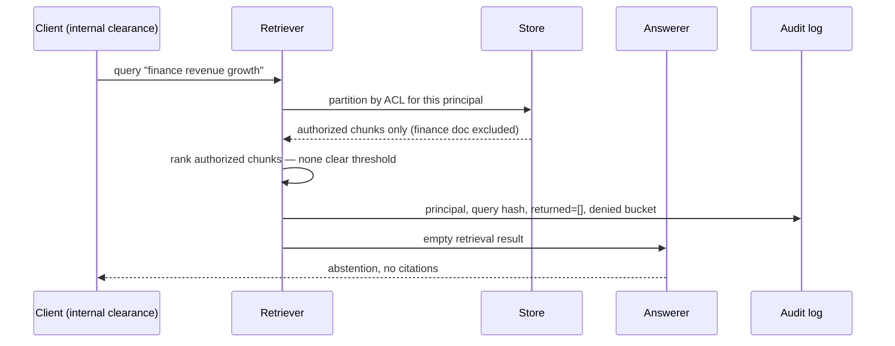

# Architecture — Enterprise RAG Governance

## Problem framing

A naive RAG system is a confidentiality incident waiting for a query:
it embeds every document into one index, retrieves by similarity, and
hands the top chunks to a model — regardless of who asked. Governance
has to be structural, not a prompt instruction. This platform makes
four claims and enforces each in code:

- **Authorization precedes relevance.** A chunk a principal may not
  read is never scored, ranked, counted exactly, or cited.
- **PII does not enter the index.** Redaction runs before chunking and
  embedding; the stored text is the redacted text.
- **Answers are evidence, not prose.** An extractive answerer composes
  answers only from retrieved authorized sentences, each with a
  chunk-level citation, and abstains when there is no such evidence.
- **Every retrieval is auditable without becoming a leak.** Audit
  entries carry the principal, a query *hash*, returned doc ids, and a
  bucketed denied count — never query text or denied titles/ids.

## Components

### Documents and principals (`models.py`, `store.py`)

A `Document` carries `owner`, `groups`, `allowed_users`, free-form
`metadata`, and a `Sensitivity` (`public < internal < confidential <
restricted`). A `Principal` carries `user_id`, `groups`, and a
`clearance` at the same levels. `Document.is_authorized` is the single
rule used everywhere: clearance at or above the sensitivity is
necessary; `public`/`internal` need nothing more; `confidential`/
`restricted` additionally require ownership, an explicit user grant,
or a shared group. One rule, one place — no endpoint re-implements it.

### Ingestion (`ingestion.py`, `pii.py`, `chunking.py`, `embedder.py`)

`IngestionPipeline.ingest` runs redact → chunk → embed → store. The
PII patterns (email, SSN-like, credit-card-like, phone) are
conservative regexes; findings are counted per kind and written to the
redaction audit *without the matched values*. Chunking produces
overlapping windows snapped to nearby boundaries, with `start_char`/
`end_char` offsets into the stored redacted text. The embedder is a
deterministic hashing embedder (unigrams + bigrams, stopwords dropped,
L2-normalised): identical text yields identical vectors in CI, demos,
and air-gapped deployments, so eval regressions are code changes, not
model drift. A hosted embedding model can replace it behind the same
`embed(text) -> tuple[float, ...]` seam.

### Retrieval (`retrieval.py`)

`PermissionAwareRetriever.retrieve` is deliberately two-phase:

1. **Filter.** Partition documents by `is_authorized(principal)`.
   Only authorized documents' chunks continue.
2. **Rank.** Cosine similarity plus a small token-overlap boost,
   sorted by `(-score, chunk_id)` for full determinism, truncated to k.
   Chunks with zero lexical overlap with the query are excluded before
   scoring — with a hashing embedder, a bucket collision is not
   relevance evidence.

Denied documents are considered a second time only to answer one
question — "did any denied document match the query terms?" — and the
answer leaves the retriever as a coarse bucket (`0`, `1-3`, `4-10`,
`11+`) via `denied_bucket()`. Exact denied counts are themselves a
side channel (learning that exactly one restricted memo mentions a
topic is a disclosure), so they are never returned or logged.

### Answering and citations (`answerer.py`)

`ExtractiveAnswerer` receives only the `RetrievalResult`. It keeps
chunks at or above `min_score`, splits them into sentences with
offsets, picks the sentences covering the most query terms (top-ranked
chunk first on ties), and joins them verbatim. Each chosen sentence
produces one `Citation(doc_id, chunk_id, start_char, end_char)` whose
offsets address the stored document text — a reviewer can verify any
sentence in O(1). If no chunk clears `min_score`, or no sentence can
be selected, the answerer returns the abstention text with **no**
citations. Abstention is the correct behaviour for "the evidence
exists but not for you" and for "the evidence does not exist" — and
the response is identical in both cases, by design.

### Evaluation (`evaluation.py`)

Golden questions pair a query and a principal with the expected
authorized doc set and an abstention expectation. `Evaluator` reports
recall@k, unauthorized-leak rate (any returned chunk from a document
the principal cannot read — the release-blocking metric, required to
be 0), citation precision (citations pointing at retrieved, authorized
chunks), and abstention accuracy, per question and averaged.

### Audit (`audit.py`)

`AuditLog` is append-only and thread-safe, optionally JSONL-backed.
Retrieval entries: principal id, query hash (SHA-256 prefix — enough
to correlate repeat queries, not enough to recover them), returned doc
ids, result count, k, denied bucket, timestamp. Redaction entries:
doc id and per-kind counts. Nothing else is ever written.

### Service & CLI (`service.py`, `cli.py`, `demo.py`)

FastAPI surface: `POST /documents` (201; 409 on duplicate, 422 on a
bad sensitivity), `GET /documents` (ids + levels only), `POST /query`
(answer + retrieval), `GET /audit`, `POST /eval`, `GET /health`. The
demo corpus (handbook, runbook, finance summary, exec-comp notes, and
a PII-bearing support note) and its golden questions are shared by the
CLI, the example script, and the tests.

## Request lifecycle (one denied query)

## Design trade-offs

- **Filter-then-rank over rank-then-filter:** post-filtering a global
  top-k both leaks (result counts and rank gaps reveal denied hits)
  and starves (authorized evidence ranked below denied hits is lost).
  Filtering first costs a full scan in this in-memory reference build;
  in production the same predicate becomes an index-time ACL field
  filter in the vector store — the semantics, not the scan, are the
  design.
- **Extractive over generative answering:** verbatim sentences make
  citation precision mechanically checkable and hallucination
  impossible by construction. The cost is fluency; a generative model
  can be layered on later only if its output is constrained to, and
  verified against, the same cited sentences.
- **Deterministic embedder over a hosted model:** weaker semantics,
  zero drift, zero keys, fully offline tests. The seam is one method.
- **Bucketed denied counts over exact counts:** operators lose a
  precise number and gain a guarantee that the audit/UI surface cannot
  be used as an oracle for restricted content.
- **Redact-and-store over store-and-mask:** masking at read time
  leaves PII in embeddings and backups. Storing only redacted text
  loses the original — acceptable for an index, whose source of truth
  remains the governed document system upstream.
